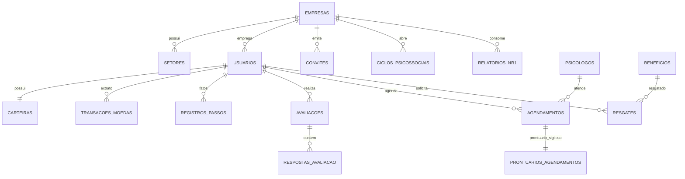

# Arquitetura Definitiva do Banco de Dados — Passo é Saúde

Este documento consolida a arquitetura técnica, as regras de conformidade (NR-1 e LGPD) e as instruções de implantação no PostgreSQL / Supabase para o ecossistema multi-tenant **Passo é Saúde**.

---

## 1. Princípios Estruturantes do Banco

1. **Conformidade Estrita com a NR-1 & LGPD (Art. 11):**
   - O empregador e o RH **nunca têm acesso a respostas individuais de burnout ou avaliações psicossociais**.
   - O RH consome exclusivamente a tabela de relatórios agregados ([relatorios_nr1](file:///c:/Users/thexe/OneDrive/Projeto%20Passos%20Sa%C3%BAde/sql/schema_completo_passo_e_saude.sql#L330-L345)), alimentada pela Stored Procedure `fn_consolidar_ciclo_nr1`, que aplica a regra de **k-anonimato ($N \ge 5$)**. Setores com menos de 5 respondentes não são divulgados individualmente.
   - O prontuário clínico é segregado na tabela [prontuarios_agendamentos](file:///c:/Users/thexe/OneDrive/Projeto%20Passos%20Sa%C3%BAde/sql/schema_completo_passo_e_saude.sql#L292-L305), sem nenhuma coluna clínica na tabela operacional [agendamentos](file:///c:/Users/thexe/OneDrive/Projeto%20Passos%20Sa%C3%BAde/sql/schema_completo_passo_e_saude.sql#L268-L290).

2. **Multi-Tenancy por Empresa (`empresa_id` + RLS):**
   - Todas as tabelas operacionais carregam a chave estrangeira `empresa_id`.
   - Tabelas de alto volume (`registros_passos`, `transacoes_moedas`, `sessoes_meditacao`) contêm `empresa_id` indexado para permitir avaliação de RLS direta e instantânea (`empresa_id = fn_empresa_atual()`).
   - A trigger de provisionamento vincula o colaborador automaticamente à empresa a partir do convite aceito.

3. **Moeda em Extrato Imutável (Ledger):**
   - A tabela `carteiras` armazena o saldo materializado, protegido pela restrição `CHECK (saldo >= 0)`.
   - A fonte da verdade é a tabela `transacoes_moedas` (append-only).
   - Inserções diretas de clientes em `carteiras` e `transacoes_moedas` são revogadas (`REVOKE INSERT, UPDATE, DELETE`). Toda movimentação ocorre via RPCs seguras (`fn_resgatar_beneficio`) e triggers internas (`fn_aplicar_transacao_moeda`).

4. **Passos Diários como Tabela de Fatos:**
   - A tabela `registros_passos` possui chave única composta `(usuario_id, data)`.
   - Garante ausência de duplicidade, cálculo ágil de sequências (*streaks*) e integridade nos recálculos noturnos de moedas.

---

## 2. Mapa dos 6 Domínios (31 Tabelas & Entidades)

---

## 3. Arquivos de Código Atualizados

Os scripts no diretório `sql/` foram revisados, corrigidos e complementados:

- **Script Unificado Completo:** [schema_completo_passo_e_saude.sql](file:///c:/Users/thexe/OneDrive/Projeto%20Passos%20Sa%C3%BAde/sql/schema_completo_passo_e_saude.sql) (Pode ser colado e executado diretamente no SQL Editor do Supabase).
- **Bloco 1 (Tipos e Empresas):** [codigo-gerado.sql](file:///c:/Users/thexe/OneDrive/Projeto%20Passos%20Sa%C3%BAde/sql/codigo-gerado.sql)
- **Bloco 2 (Usuários e Convites):** [codigo-gerado2.sql](file:///c:/Users/thexe/OneDrive/Projeto%20Passos%20Sa%C3%BAde/sql/codigo-gerado2.sql)
- **Bloco 3 (Gamificação e Passos):** [codigo-gerado3.sql](file:///c:/Users/thexe/OneDrive/Projeto%20Passos%20Sa%C3%BAde/sql/codigo-gerado3.sql)
- **Bloco 4 (Saúde Mental e Apoio Clínico):** [codigo-gerado4.sql](file:///c:/Users/thexe/OneDrive/Projeto%20Passos%20Sa%C3%BAde/sql/codigo-gerado4.sql)
- **Bloco 5 (Benefícios):** [codigo-gerado5.sql](file:///c:/Users/thexe/OneDrive/Projeto%20Passos%20Sa%C3%BAde/sql/codigo-gerado5.sql)
- **Bloco 6 (NR-1 e Auditoria):** [codigo-gerado6.sql](file:///c:/Users/thexe/OneDrive/Projeto%20Passos%20Sa%C3%BAde/sql/codigo-gerado6.sql)
- **Views de Consumo:** [codigo-gerado (consumo).sql](file:///c:/Users/thexe/OneDrive/Projeto%20Passos%20Sa%C3%BAde/sql/codigo-gerado%20%28consumo%29.sql)
- **Bloco 7 (RLS e Permissões):** [codigo-gerado7.sql](file:///c:/Users/thexe/OneDrive/Projeto%20Passos%20Sa%C3%BAde/sql/codigo-gerado7.sql)
- **Trigger de Provisionamento:** [codigo-gerado-trigerprovisionamento.sql](file:///c:/Users/thexe/OneDrive/Projeto%20Passos%20Sa%C3%BAde/sql/codigo-gerado-trigerprovisionamento.sql)

---

## 4. Guia de Configuração do Supabase Storage

Crie no painel do Supabase (**Storage > New Bucket**) os seguintes 4 buckets:

| Nome do Bucket | Visibilidade | Política de Acesso |
|---|---|---|
| `avatares` | Privado | Usuários autenticados podem enviar e atualizar apenas seu próprio avatar (`(storage.foldername(name))[1] = auth.uid()::text`). Leitura para autenticados da mesma empresa. |
| `empresas-logos` | Público | Escrita apenas para administradores da plataforma e RH da empresa (`fn_eh_rh()`). Leitura pública. |
| `meditacoes-audio` | Público | Escrita restrita a `admin_plataforma`. Leitura pública para usuários autenticados. |
| `beneficios` | Público | Escrita restrita ao RH da empresa ou `admin_plataforma`. Leitura para colaboradores. |

---

## 5. Rotinas e Processos em Background (Cron Jobs)

No PostgreSQL (usando a extensão `pg_cron` nativa do Supabase) ou via Edge Functions agendadas:

1. **Crédito Noturno de Passos $\to$ Moedas (00:05 diariamente):**
   - Varre a tabela `registros_passos` do dia anterior.
   - Aplica a `regras_pontuacao` da empresa do colaborador.
   - Gera as transações correspondentes com limite máximo diário respeitado.
2. **Expiração Automática de Convites (01:00 diariamente):**
   - Atualiza `convites.situacao = 'expirado'` onde `expira_em < now() AND situacao in ('pendente', 'enviado')`.
3. **Doação Mensal da Empresa para Apoio Psicológico (1º dia de cada mês):**
   - Credita moedas com tipo `doacao_empresa` nas carteiras dos colaboradores conforme `empresas.moedas_apoio_mensais`.
